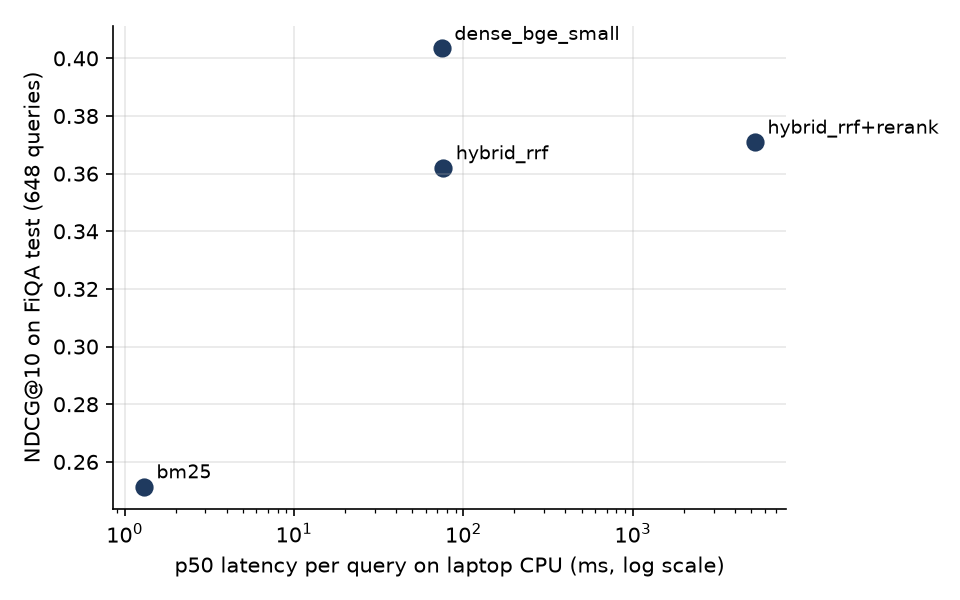

# fiqa-rag-eval: which retrieval stages actually earn their latency?

A retrieval ablation for a financial RAG system on **FiQA-2018** (BEIR): 57,638 financial forum answers and
**648 test queries** with human relevance labels. Each stage that a "standard" RAG stack adds is measured for
quality, latency and memory, with a paired bootstrap on every comparison.



## Results (`reports/results.json`, laptop CPU: i7-1365U, no GPU)

| Retriever | NDCG@10 | Recall@100 | MRR@10 | p50 / p95 latency |
|---|---:|---:|---:|---:|
| BM25 (`bm25s`, stemming + stopwords) | 0.251 | 0.559 | 0.308 | 1.3 / 5.1 ms |
| **Dense: `bge-small-en-v1.5`** | **0.404** | **0.696** | **0.488** | 75 / 87 ms |
| Hybrid: BM25 + dense, RRF (k = 60) | 0.362 | 0.693 | 0.432 | 76 / 89 ms |
| Hybrid + cross-encoder rerank (top 50, `ms-marco-MiniLM-L-6-v2`) | 0.371 | 0.693 | 0.441 | 5,262 / 7,003 ms |

Paired comparisons on NDCG@10 (2,000 bootstrap resamples over queries):

| Change | Δ NDCG@10 | 95% CI | Queries better / worse |
|---|---:|---|---:|
| BM25 → dense | **+0.152** | +0.129 to +0.176 | 317 / 85 |
| dense → hybrid (RRF) | **−0.041** | −0.059 to −0.025 | 154 / 209 |
| hybrid → + rerank | +0.009 | −0.006 to +0.024 (not significant) | 180 / 166 |

Sanity check: BM25 and bge-small land close to their published FiQA scores (about 0.24 and 0.40), so the
pipeline and metrics are not the reason for the findings below.

## What I would ship, and why

**Dense retrieval alone.** It is the best system on every metric. The two stages usually added next made things
worse or slower:

- **Hybrid hurt.** On FiQA, BM25 is so much weaker than dense that fusing the two ranks pulls BM25's mistakes
  into the top 10: 209 queries got worse vs 154 better. "Hybrid is always safer" is a claim to test per dataset,
  not a default.
- **Reranking was not worth it here.** +0.009 NDCG@10 (CI includes 0) for **70× the latency** (5.3 s per query on
  CPU). The reranker is trained on MS MARCO web search, not financial Q&A, and it reranks the weaker hybrid pool.
- **Cost of dense:** an 88.5 MB index for 57,638 documents (384-dim float32), brute-force search, no vector
  database needed at this size. Most of the 75 ms is encoding the query on CPU.

## Limits and next experiments

- The reranker was tested on hybrid candidates only. Reranking the **dense** top 50, and a finance-tuned or
  larger reranker, are the next runs.
- Retrieval only: answer generation and faithfulness are not measured yet. Recall@100 = 0.70 is the ceiling any
  generator gets from this retriever.
- Building the dense index took 1 h 50 min on a busy laptop CPU (other jobs were running); it is cached in
  `.cache/` and never recomputed.
- One embedding model size. A bigger model would trade index size and latency for quality; worth measuring before
  adding any other stage.

## How it is built

```
rag/data.py       FiQA corpus, test queries, qrels (BEIR copies on Hugging Face)
rag/metrics.py    NDCG@k, Recall@k, MRR@k, RRF (unit-tested against hand-computed values)
scripts/run_eval.py  each stage cached in .cache/ -> reports/results.json, per_query.json
scripts/plot.py      -> reports/figures/quality_vs_latency.png
```

- **RRF instead of adding scores:** BM25 and cosine scores have different scales per query; RRF uses ranks only.
- **Per-query results are saved**, so every average can be broken down and every bootstrap re-run.
- **Test split only, no tuning on it:** RRF k = 60 and rerank depth 50 are standard defaults, fixed before the run.

## Run it

```bash
pip install -r requirements.txt
pytest -q                     # metric tests
python scripts/run_eval.py    # first run is slow on CPU (dense index + reranking); later runs use .cache/
python scripts/plot.py
```

## Interview questions this project prepares for

1. Why can hybrid retrieval be worse than its best component?
2. When would you still keep a reranker that adds 0.009 NDCG?
3. Why is Recall@100 the number the generator team cares about?
4. What would you change to get the 75 ms dense latency under 20 ms?
